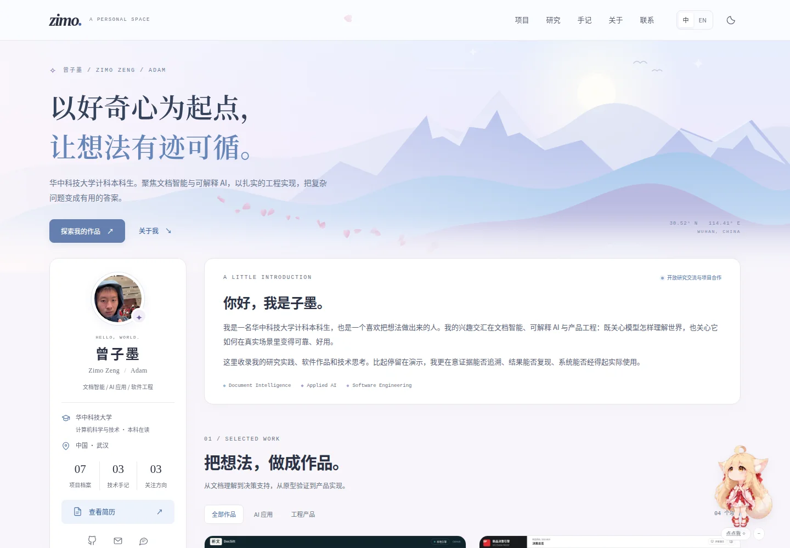

# Zimo’s Personal Space · 曾子墨的个人主页

**文档智能 · AI 应用 · 软件工程**
Document intelligence. Applied AI. Thoughtful engineering.

- **在线访问 / Live:** https://lifelonglearneradam.github.io/Myweb/
- **English:** https://lifelonglearneradam.github.io/Myweb/?lang=en
- **中英文简历 / Résumé:** https://lifelonglearneradam.github.io/Myweb/resume.html



从大一实践课网页重新设计的个人空间：以暖白、天蓝、浅紫与樱粉为底色，保留个人博客的头图、侧栏、内容卡片与陪伴式向导，也让研究方向、工程项目和证据入口可以被快速浏览。

A bilingual personal portfolio and small technical blog, rebuilt from a first-year course website. Warm whites, sky blue, lilac, and blossom pink frame a panoramic header, personal sidebar, research notes, and inspectable project case studies.

## 内容 / Content

- **7 份项目档案**：DocSift、AI 新品决策引擎、QuantPilot AI、子墨记账、SAT / 星形数独、DecibelMeter、手写文档表格与公式缺陷分析。
- **研究专题**：明确个人承担的表格 / 公式诊断范围，链接公开报告；区分评测、训练与待验证工作。
- **3 篇中英文手记**：围绕文档解析评测、可核验的 AI 交互、本地优先工程整理；附文章目录、深链接与复制链接。
- **完整归档与搜索**：统一检索 7 份项目与 3 篇手记，支持中英文关键词、类型筛选与可分享的搜索 URL。
- **教育与课程实践**：在校课程与 CS:APP 自学区分，不公开学号、课程原始材料或作业原包。
- **中英文简历**：随页面语言切换，浏览器打印 / 保存为 PDF 时自动使用简洁 A4 布局。
- **公开联系**：GitHub 与邮箱，不公布电话号码、私人社交账号或私人相册。

内容依据与更新原则见 [`docs/CONTENT.md`](docs/CONTENT.md)。手记是本轮结合项目实现新整理的草稿，未伪造历史发表日期；作为正式申请材料使用前，建议本人复核表达与个人贡献。

## 交互 / Interaction

- **完整中英文切换**：正文、项目详情、手记、简历、按钮、向导与无障碍标签，均有两种语言；支持 `?lang=zh` / `?lang=en` 和本地偏好保存。
- **浅色 / 深色主题**：首次跟随系统，可手动切换并记住选择。
- **樱花效果**：鼠标经过留下散落花瓣，辅以稀疏的背景飘落；粒子数有上限，不拦截点击。
- **花树转场**：首页与转场使用 gpt-image-2.6 生成的樱花古树、湖面和蓝紫远山场景。首次进入、章节跳转与站内换页配合花瓣与柔和揭幕；不是官方图片。
- **动漫头像与涂山苏苏向导**：不展示真人照片；非官方同人动画；待机、眨眼、招手、跳跃、16 方向视线跟随、章节导航与间隔提示。手机默认收起，可随时展开 / 收起。
- **性能与舒适度**：离开标签页暂停动画；遵循 `prefers-reduced-motion`；页脚可以关闭樱花与转场。滚动时内容轻柔显现，顶部显示阅读进度。没有统计、广告、第三方字体或聊天模型请求。
- **卡农钢琴循环**：Lee Galloway 演奏的《D 大调卡农》，本地托管 Ogg，默认轻音量、可暂停 / 调节音量，并跨页恢复位置。尝试有声自动播放，被浏览器拦截时等待第一次真实交互，不绕过浏览器策略。音源按 CC BY-SA 3.0 使用，见 [`assets/audio/ATTRIBUTION.md`](assets/audio/ATTRIBUTION.md)。
- **兼容旧链接**：原始根目录与 `web/` 下的旧页面跳转到新版对应章节。

> 苏苏**向导动画**为 **legeling** 制作的 AI 生成社区同人演绎，并非官方 Live2D；头像与场景则为本轮单独生成，分别说明来源。仅限非商业使用，见 [公开致谢](https://lifelonglearneradam.github.io/Myweb/credits.html) 与 [`assets/images/ATTRIBUTION.md`](assets/images/ATTRIBUTION.md)。角色权利归原权利人。若改作商业产品，请更换素材或另行取得授权。

## 技术方案 / Technical approach

**原生 HTML + CSS + JavaScript**，无生产依赖、无构建步骤、无需服务端，直接部署到 GitHub Pages。

- CSS Grid / Flexbox、CSS 变量、响应式布局、打印样式。
- Canvas 樱花粒子 + CSS 花树转场。
- 本地 WebP 精灵图向导，独立实现动画运行时；不加载外部 Live2D 或桌宠脚本。
- 本地系统字体；生成的场景与头像、SVG 项目示意图和压缩的 WebP 图片。生图调用只在制作阶段进行，网站运行时不使用图像 API，不包含接口配置或密钥。
- 动态内容先转义再渲染；外链使用 `noopener noreferrer`；无密钥、账号凭证或私人服务器信息。

```text
MyWeb/
├── index.html                  # 主页 / Homepage
├── archive.html                # 项目与手记的搜索归档
├── project.html                # 项目档案：?id=docsift 等
├── note.html                   # 技术手记：?id=local-first 等
├── resume.html                 # 中英文可打印简历
├── credits.html                # 设计、素材与隐私说明
├── 404.html
├── assets/
│   ├── css/site.css            # 全站样式、移动端与打印
│   ├── js/content.js           # 个人资料、中英文文案、项目与手记
│   ├── js/app.js               # 语言、主题、页面渲染与交互
│   ├── js/effects.js           # 樱花与花树转场
│   ├── js/mascot.js            # 苏苏动画与向导
│   ├── js/music.js             # 轻音量卡农、播放偏好与跨页位置
│   ├── audio/                  # 原始授权录音与署名
│   ├── js/theme-init.js        # 首屏主题
│   └── images/                 # 本地素材与署名
├── web/                        # 旧链接兼容入口
├── tests/                      # 内容测试、浏览器回归测试
├── scripts/check_site.py       # 静态链接、资源与公开数据检查
├── docs/                       # 预览、内容依据、域名指南
├── .github/workflows/validate.yml
├── .nojekyll
├── robots.txt
└── sitemap.xml
```

原 `css/`、`js/` 目录不再被新版引用，保留以避免覆盖本地旧版本工作。

## 本地运行 / Run locally

```bash
python3 -m http.server 4173 --bind 127.0.0.1
# 打开 / Open http://127.0.0.1:4173/
```

也可执行 `npm run dev`。不需要 `npm install`，没有依赖下载或构建。

## 检查 / Validation

需要 Node.js 20+ 与 Python 3：

```bash
npm run check
```

包括 JavaScript 语法、中英文词条一致性、7 份项目 / 3 篇手记的完整性、素材存在性、外链安全属性、旧页跳转、HTML / CSS 本地引用、站点地图与意外公开的敏感信息检查。GitHub Actions 自动执行相同检查。

浏览器回归（已安装 `playwright-cli` 时）：

```bash
playwright-cli open http://127.0.0.1:4173/
playwright-cli run-code --filename=tests/browser-checks.js
playwright-cli run-code --filename=tests/experience-checks.js
```

测试覆盖桌面 / 平板 / 手机、320–1440 px、中英文、深浅主题、筛选、剪贴板、菜单键盘操作、向导、动效偏好、详情 / 文章 / 简历 / 旧链接与本地资源错误。也在 `/Myweb/` 子路径下执行，防止 GitHub Pages 路径失效。新增的体验检查覆盖归档搜索、URL 状态、文章目录 / 深链接、真实音频解码、暂停 / 音量偏好与跨页播放位置。

## 修改内容 / Updating content

1. 修改 `assets/js/content.js` 中 `profile`、`ui.zh / ui.en`、`projects`、`notes`。
2. 两种语言同时更新；若增加项目，更新头像卡统计、站点地图与测试数量断言。
3. 截图或示意图放入 `assets/images/`，检查许可，不上传账号信息或私人数据。
4. 在项目中写清个人 / 团队范围、可查看的代码 / 报告、结果与验证条件。
5. 跑 `npm run check`，再做浏览器预览。

## 发布 / Deployment

现有仓库默认分支为 `main`，GitHub Pages 从 **`master` / 根目录** 发布。两条分支本轮以非强制快进方式同步，保留历史。

```bash
git add <明确列出的站点文件>
git commit -m "Update personal site"
git push origin HEAD:master HEAD:main
```

不要盲目 `git add -A`：目录内可能存在未选择公开的个人图片。不要使用 `--force` 覆盖远端历史。

**免费域名候选：`zimo.is-a.dev`。尚未获批，不是已生效网址。** 社区明确限制 AI 代建申请 PR，需由本人按照 [`docs/DOMAIN.md`](docs/DOMAIN.md) 完成人工申请；通过后再设置 CNAME / HTTPS，不提前破坏原站。

## Design references

- [Suwa shrine](https://sukunahust.moe/) — 个人博客结构与陪伴式交互。
- [Anthropic](https://www.anthropic.com/) — 留白与编辑式排版。
- [Brittany Chiang](https://brittanychiang.com/) — 清晰、可读的项目与经历叙事。

本网站重新实现布局和交互，不复用参考站的文章、个人经历或角色插画。
